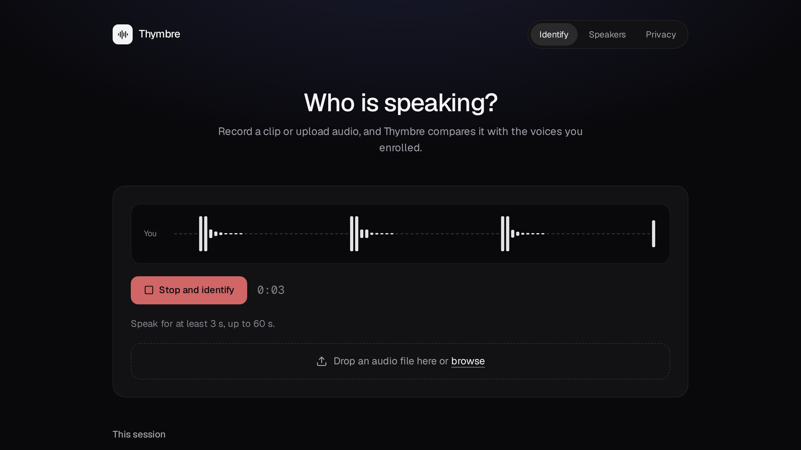
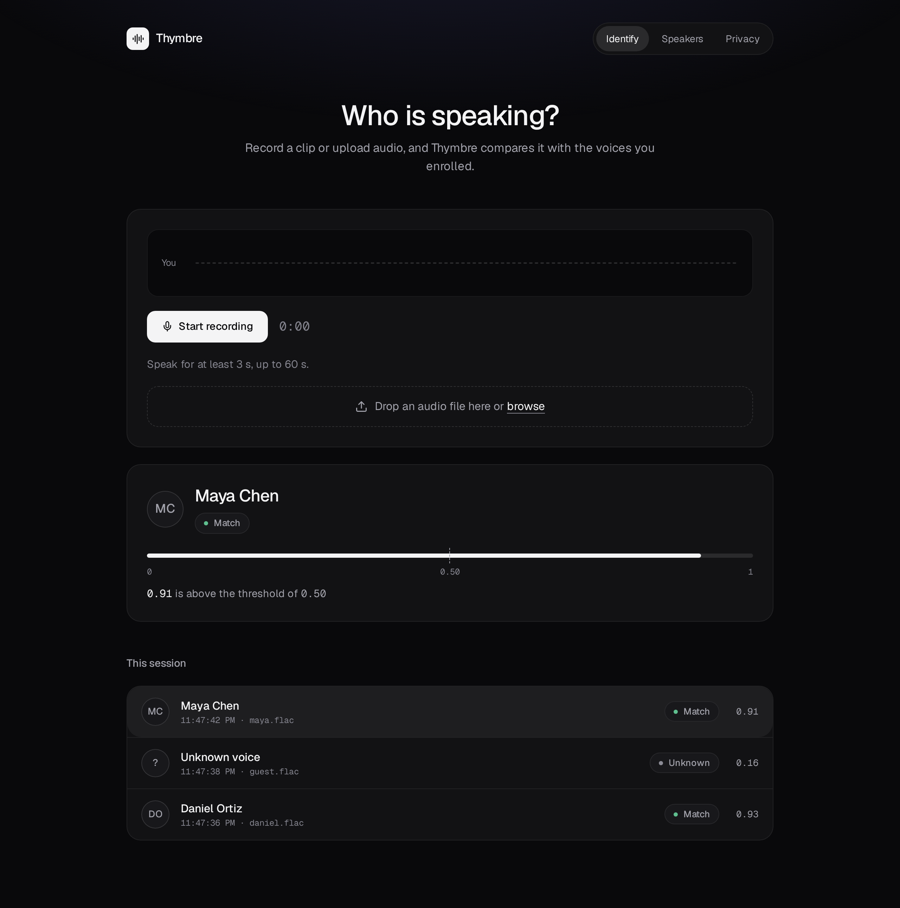
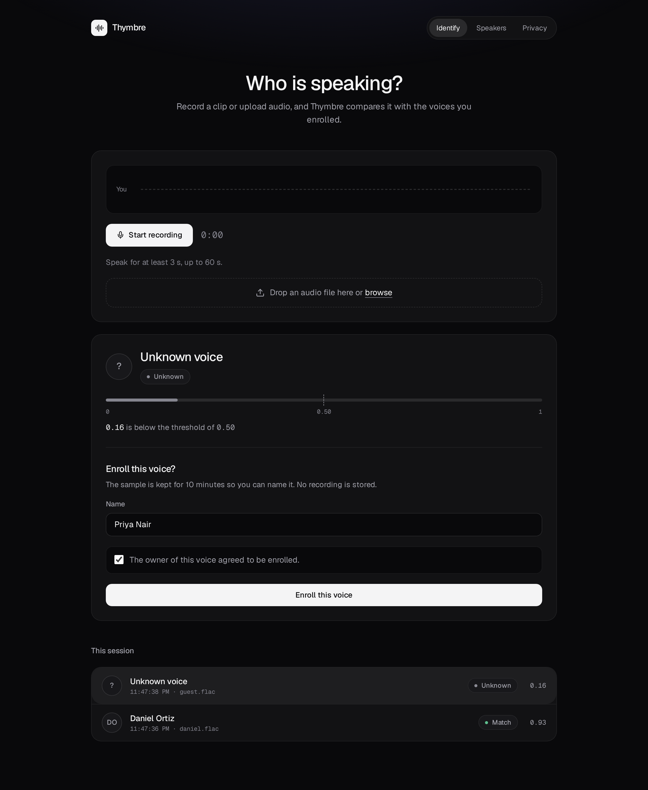
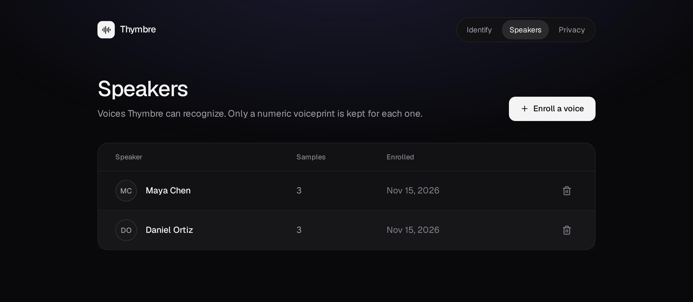
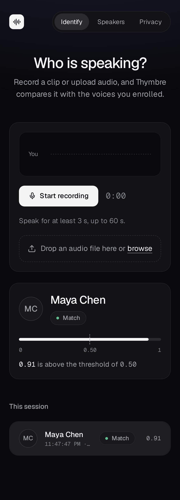

<h1 align="center">Thymbre</h1>

<p align="center">
  Open source voice biometrics. Enroll a voice once, then find out who is speaking in a recording or an audio file.
</p>

<p align="center">
  <a href="https://github.com/HexAbyss/Thymbre/actions/workflows/ci.yml"></a>
  <a href="LICENSE"></a>
</p>

<p align="center">
  
</p>

Thymbre is a self-hosted **speaker identification** system. It answers "who is speaking?", not "what was said". You enroll a person's voice from a few short clips, and later you send it a recording from the browser microphone or an audio file. It replies with the closest enrolled voice and how sure it is, or tells you the voice is unknown. It comes with a REST API, a web interface and a Postgres store, and it runs on your own machine with Docker. No cloud service, no API keys, and no raw audio is kept.

## What it does

- **Enroll a voice** from a few short clips. Thymbre keeps a numeric voiceprint and never the recording.
- **Identify a speaker** from the microphone or an uploaded file. The answer is a match, an unknown voice, or "not sure", always with its similarity score.
- **Enroll on the spot.** When a voice matches nobody, you can name it and enroll it from the same screen, after confirming that its owner agreed.
- **Delete any voice**, together with all of its samples.

The score is drawn against the decision threshold, so you can see how close a result was and not only what it was.

## Screenshots

<p align="center">
  
  &nbsp;
  
</p>

<p align="center">
  
</p>

<p align="center">
  
</p>

The screenshots use sample voices from [LibriSpeech](https://www.openslr.org/12) (CC BY 4.0) with made-up names.

## Why Thymbre

Thymbre is the whole application around speaker identification: an API to enroll and identify voices, a database that searches by similarity, a web interface, a flow for voices nobody has enrolled yet, a consent step, and a script that measures error rates on your own audio. Use it to try speaker identification, build it into a project, or test it on your recordings without assembling those pieces yourself.

## Use the API

```bash
# Enroll a voice from one or more clips
curl -F name="Maya" -F files=@clip1.wav -F files=@clip2.wav http://localhost:8000/speakers

# Identify who is speaking in a recording
curl -F file=@recording.wav http://localhost:8000/identify
```

```json
{
  "status": "match",
  "speaker": { "id": "578c2ef5-d1bf-439e-8b0a-9c4b610a6951", "name": "Maya" },
  "score": 0.91,
  "clip_id": null
}
```

`status` is `match`, `unknown` or `uncertain`. An unknown voice comes with a `clip_id` that lets you enroll it later without sending the audio again. The full API is documented at `/docs` while the service runs.

## How it works

1. The audio is decoded to mono 16 kHz and the silence is removed.
2. A speaker model (ECAPA-TDNN from SpeechBrain) turns the speech into a vector of 192 numbers, the voiceprint.
3. The voiceprint is compared with the enrolled voices in Postgres (pgvector), by cosine similarity.
4. If the closest voice is above the threshold, it is the answer. If not, the voice is unknown.

The design is described in [docs/ARCHITECTURE.md](docs/ARCHITECTURE.md). The stack is Python with FastAPI, Postgres with pgvector, SpeechBrain, and a Next.js interface, all run with Docker Compose.

## Run

```bash
cp .env.example .env
docker compose up --build
```

| Service | Address |
|---|---|
| Web interface | http://localhost:3100 |
| API and its interactive docs | http://localhost:8000 and http://localhost:8000/docs |

The backend applies database migrations on startup. The first identification downloads the speaker model, which is cached in a Docker volume. After that it works offline.

## Questions

**Is this speech recognition?** No. It identifies who is speaking, not what is said.

**How accurate is it?** On the LibriSpeech test-clean set, the default threshold accepted no strangers and rejected 0.7% of enrolled voices. That is clean English read speech. Phone calls and noisy rooms score lower, so measure on your own audio. See [docs/CALIBRATION.md](docs/CALIBRATION.md).

**Does it need a GPU?** No. It runs on the CPU.

**Does it store my recordings?** No. Audio is analyzed in memory and discarded. Only the voiceprint of an enrolled voice is stored.

**Which languages does it work with?** It has only been evaluated on English speech.

**Can I use it in a product?** The code is Apache 2.0. The speaker model has its own terms, because it was trained on VoxCeleb. Read the notes in [NOTICE](NOTICE) first.

## Test

```bash
# Backend: lint, format and tests (the tests use the db service)
docker compose run --rm --no-deps backend sh -c "ruff check . && ruff format --check ."
docker compose run --rm backend pytest
# Add -e RUN_MODEL_TESTS=1 and the path tests/test_real_models.py to test the real models

# Frontend: lint, type check and tests, run as a Docker build
docker build --target check -f src/frontend/Dockerfile .
```

## Status and roadmap

Thymbre is an early release. Identification works from start to finish, but there is no login yet, so run it on a machine or a network you trust and do not expose it to the internet. Planned next: identification while someone is still talking, several speakers in one recording, and protection against replayed or synthetic voices. The work is tracked in the [open issues](https://github.com/HexAbyss/Thymbre/issues), and a few of them are good places to start.

## Privacy

A voice identifies a person. Enroll only people who agreed to it. Thymbre does not store raw audio, and any enrolled voice can be deleted. See [SECURITY.md](SECURITY.md).

## Contributing

Bug reports, ideas and pull requests are welcome. See [CONTRIBUTING.md](CONTRIBUTING.md) for the layout, the workflow and the testing rules. If Thymbre is useful to you, a star helps other people find it.

## License

Apache License 2.0. See [LICENSE](LICENSE) and [NOTICE](NOTICE).
